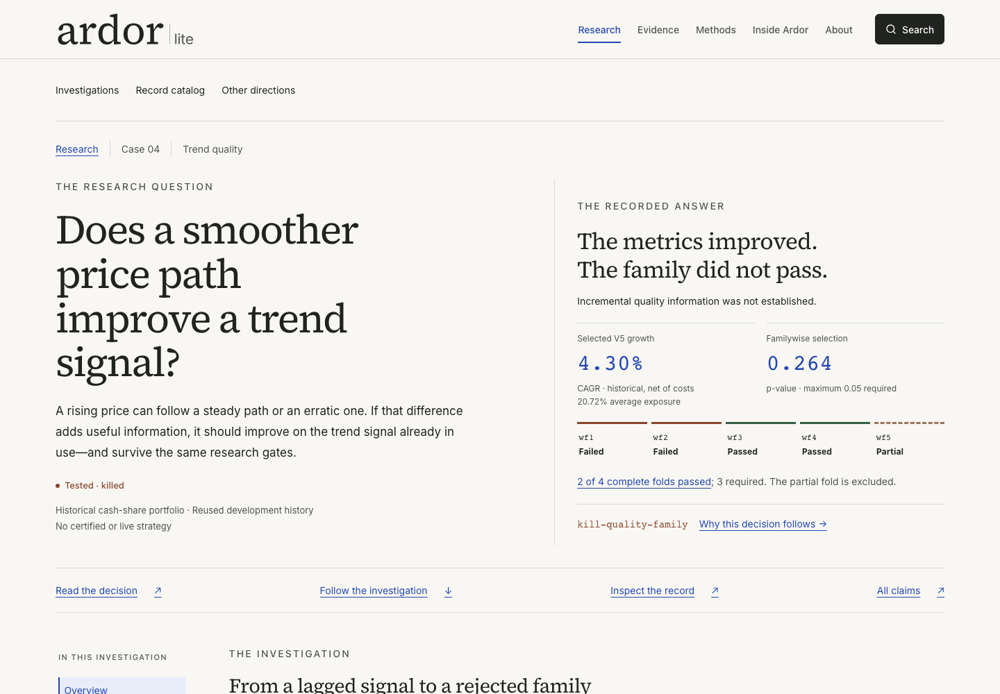
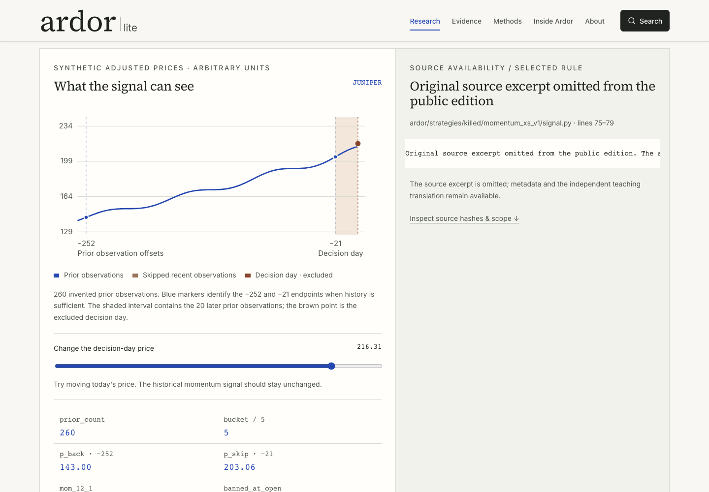
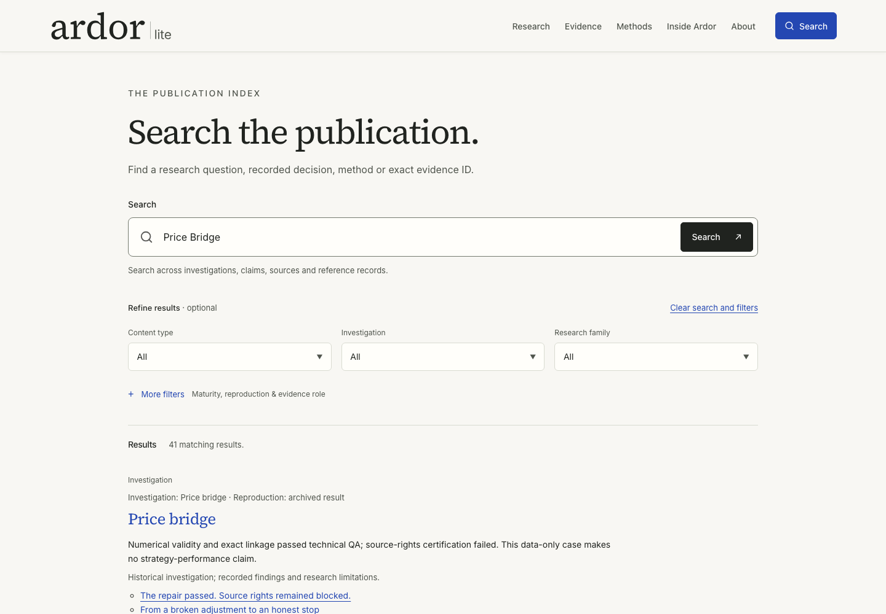

# Ardor Lite

A static research publication that follows six Indian-equity investigations from question to experiment, evidence and recorded decision. It is the reading and inspection layer for **Ardor**, an independently built personal research system.

**Website:** [ardorlite.onrender.com](https://ardorlite.onrender.com/) · **Public source:** [ArdorLite](https://github.com/sumnlikeshane/ArdorLite)

The project makes failed hypotheses, intermediate successes and unresolved limits inspectable. Its reviewed evidence supports **no certified or live strategy**. Synthetic demonstrations explain software behavior; they do not reproduce historical returns.


## What to inspect

Start with a case, follow its figures and exact-value references, then inspect the implementation that preserves those relationships.

| Investigation | Bounded outcome |
| --- | --- |
| [Atlas & SSF](reviewed/2026-10-11/content/cases/atlas-ssf.md) | Discovery did not nominate a strategy; futures translation failed execution, cost and capacity requirements. |
| [Momentum v2](reviewed/2026-10-11/content/cases/momentum-v2.md) | Intermediate execution stress passed; attribution rejected an independent residual edge. |
| [Swing autopsy](reviewed/2026-10-11/content/cases/swing-autopsy.md) | Corrected accounting and exit diagnostics did not establish an edge. |
| [Trend quality](reviewed/2026-10-11/content/cases/trend-quality.md) | Selected metrics failed incremental-information and familywise gates; complete and partial folds remain separate. |
| [Delivery & insider](reviewed/2026-10-11/content/cases/delivery-insider.md) | Co-occurrence did not establish predictive forward interaction; historical source binding remains unresolved. |
| [Price Bridge](reviewed/2026-10-11/content/cases/price-bridge.md) | Numerical repair and exact linkage passed technical checks; source-rights certification failed. |

The site contains six cases, **114 overlapping catalog records** (not independent strategy trials), 204 claims, 18 figure/table relationships, five synthetic method explanations and 110 individually mapped reviewed exports. The immutable evidence snapshot is dated 11 October 2026. Authored explanations and metadata-only source provenance are separate layers. Private source captures and the local-only Trend supplement are excluded from this public repository.

After starting the local preview:

- `/research/cases/trend-quality/`: argument-led reading with figures, equivalent tables and complete references.
- `/research/walkthrough/`: a fictional TypeScript momentum model with source-reference metadata; private Python excerpts are omitted.
- `/research/cases/price-bridge/#bridge-experience`: fictional repair/linkage/rights presets.
- `/engineering/`: source-backed explanations of the research pipeline and its limits.
- `/evidence/claims/`, `/evidence/sources/` and `/research/catalog/`: exact identities and links back to consuming evidence.
- `/search/`: Pagefind topic search, exact-ID lookup and filters, using a production build.

<details>
<summary>More interface screenshots</summary>

These are Chromium captures of the public website from 2 November 2026. They document the interface; they do not establish scientific, human-reader or accessibility acceptance.





</details>

## Run locally

Use **Node 24.21.0**, **pnpm 10.14.0** and ordinary, nonoptimized **Python 3.12**. Python build checks use the standard library. Put the pinned runtimes on `PATH`; pnpm can be installed with `npm install --global pnpm@10.14.0`.

From the root of your cloned repository:

```sh
export PYTHONDONTWRITEBYTECODE=1
./scripts/run.sh install --frozen-lockfile
./scripts/run.sh build
./scripts/run.sh preview --port 4321 --ignore-lock
```

Open the exact loopback URL printed by the read-only preview; stop preview with Ctrl-C. The wrapper prefers the prepared Mac's working Node 24 installation, otherwise it uses `PATH`. The complete build checks exact Node/pnpm versions. Installation uses the package registry; building and reading then use local assets. No environment file, API key, account, database, broker, market-data service or private Ardor checkout is needed.

For UI work, use `./scripts/run.sh dev`. Test search through the built HTTP preview: development mode does not generate its index. See [BUILD.md](docs/BUILD.md) for the full pipeline and browser setup.

## Architecture and decisions

```text
Frozen evidence + authored overlays + public provenance
                ↓ schema, identity and reference validation
Allowlisted assets → Astro static HTML/CSS/TypeScript → Pagefind index
                ↓ route, value, link and byte audit
                      dist/ → local preview
```

| Layer | Implementation and tradeoff |
| --- | --- |
| Reading UI | Astro, strict TypeScript, semantic HTML and custom CSS. Core reading works without JavaScript; search and teaching controls require it. No server adapter or editing endpoint. |
| Evidence | JSON/Markdown, Zod schemas and a typed crosswalk join records, claims, sources and figures. Immutable originals require authored overlays for corrections. |
| Teaching | TypeScript models and Observable Plot, with explicit fictional inputs. Source-reference metadata preserves provenance; private excerpts are omitted and the browser does not run the original strategies. |
| Search | Pagefind generates a local index and canonical anchored destinations. No hosted search service, but every content change needs a rebuild. |
| Integrity | Python/Node tools enforce snapshot hashes, material boundaries, guarded exports and source/build/output bindings. These checks cannot establish research validity or grant rights. |
| Verification | Node/Python regressions, output-boundary tests, Playwright and axe diagnostics. Vale is advisory; scientific and independent-human acceptance remain distinct. |

```text
src/                       Static pages, components, content, models and browser code
reviewed/2026-10-11/        Immutable evidence snapshot (135 files)
snapshots/                 Frozen-tree identity contract
config/                    Routes, asset map, material and release policies
scripts/                   Build and shared validation tools
tests/                     Model, contract, output and browser regressions
public/                    Static assets/notices and generated allowed derivatives
docs/                      Build, architecture and project screenshots
receipts/                  Locally generated verification evidence
.github/                   Pinned CI, dependency updates and security reporting policy
```

`dist/`, `generated/`, dependencies, packages and browser recordings are generated and ignored. The [architecture guide](docs/ARCHITECTURE.md) explains the static build, public provenance and excluded private inputs.

## Validate and maintain

```sh
./scripts/run.sh check              # Evidence/content and Astro/TypeScript checks
./scripts/run.sh build              # Complete pipeline, including regressions
```

Browser checks require matching engines and local process/loopback access:

```sh
./scripts/run.sh exec playwright install chromium firefox webkit
./scripts/run.sh test:e2e --output receipts/playwright-my-check
```

Use a fresh browser-output directory to preserve prior runs. Receipts apply only to their recorded source/output identities. GitHub CI runs the public build, history secret scan and dependency audit with pinned actions and read-only tokens. These technical checks do not supply scientific or human acceptance.

You can inspect and build your own clone or fork. Shared validation is included; owner mutation tools, drafts, private inputs and full operational records stay in external local storage. Public read/clone access grants no upstream write, merge, administrative or deployment authority. There is no browser admin, CMS, production write service or runtime database. See [contribution rules](CONTRIBUTING.md) and [security](SECURITY.md).

## Status and limits

The website is available at [ardorlite.onrender.com](https://ardorlite.onrender.com/). This repository is the single maintained website source for independent reviewers, CI and the intended Render source. Its required public-site input contract supplies metadata-only provenance; original source captures, the local-only Trend supplement, private explanatory inputs, drafts and owner mutation tools remain outside public Git. Missing original-input verification is reported as absent. An explicit local pre-release audit checks retained private inputs against this exact public projection and source. The read-only provider entry point runs the same build and rejects missing/wrong source, output, target and approval bindings. Local preparation does not authorize a deployment. See [deployment](docs/DEPLOYMENT.md) and [maintenance](docs/MAINTENANCE.md).

Full independent scientific, human-reader, assistive/device, zoom/print and remaining browser/performance acceptance is incomplete. Technical checks and agent diagnostics do not fill those gaps. Research limitations include unrecovered historical source identities, reconstructed artifacts and absent daily Trend NAV; no replacement evidence is synthesized.

Useful references: [instructions](AGENTS.md), [build guide](docs/BUILD.md), [architecture and evidence boundary](docs/ARCHITECTURE.md), [public source profile](config/source-profile.json), [contribution rules](CONTRIBUTING.md) and [security](SECURITY.md). Search uses Pagefind 1.5.2 with a checksum-pinned, unmodified upstream WASM pair and canonically ordered metadata/filter tables. Its MIT notices remain under `vendor/pagefind-1.5.2/`; they do not license Ardor research.

## Rights

**Reserved rights; no blanket open-source licence is granted.** See [NOTICE.md](NOTICE.md), the immutable snapshot's notices and material-specific attribution. Fonts, icons and dependencies retain their own licences. A reviewed derivative or source excerpt does not license its original source, and website-export clearance does not clear the whole source repository or Git history.

Original reports, raw market rows, private ledgers and complete source engines remain outside website exports. Historical filesystem paths are provenance labels, not runtime dependencies. Retain all shipped material, dependency and font notices. See the [architecture guide](docs/ARCHITECTURE.md) for the public/private evidence boundary.
