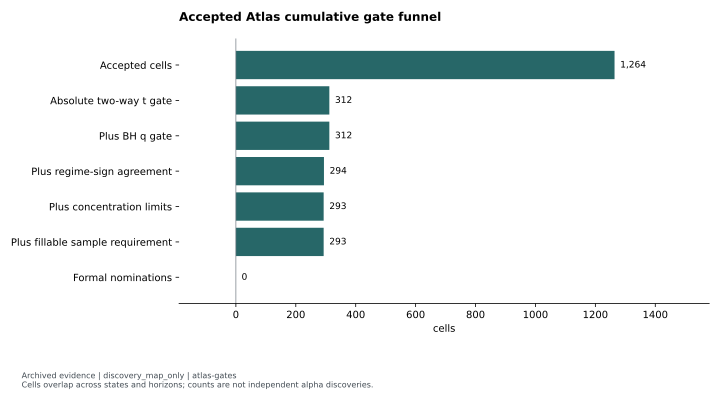
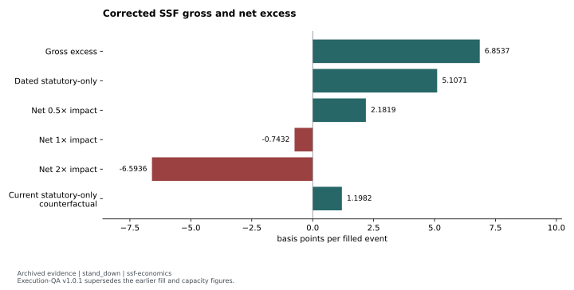
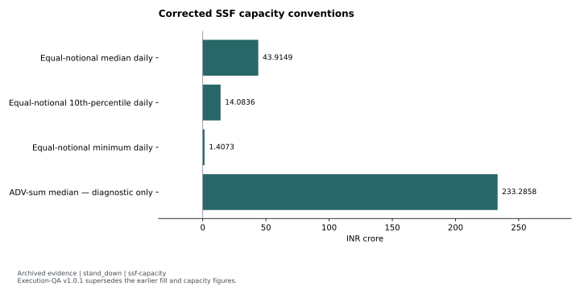

# Atlas base rates and the SSF execution translation

**Atlas status:** `discovery_map_only`. Original verdict: “discovery atlas complete; no cell formally nominated”. **Follow-up status:** `stand_down`. Corrected source verdict: `STAND_DOWN`.

The accepted Atlas identified conditional historical base rates, but nominated no strategy. Its separately frozen close-location/downside follow-up produced positive gross excess on single-stock futures (SSF), then failed execution, cost and capacity requirements. Discovery significance and executable net value were different tests.

## Hypothesis and clocks

Atlas asked which predeclared daily price states and permitted state pairs were associated with forward cash-price excess. It observed the signal at the close, entered at the next adjusted open and marked at the horizon close. Both its liquid-cash and point-in-time F&O membership lenses measured **cash** returns against the same eligible equal-weight universe. The discovery window was 2016-01-01 through 2024-12-31. Its 2025-01-01 through 2026-06-05 holdout remained unopened for this study; other Ardor families consumed overlapping calendar dates.

The follow-up asked whether the bottom daily-return tail combined with low close-location value could support intraday SSF shorts. It observed cash features after close, entered near-month SSF at the next market-session open and covered at that same non-expiry session's settlement. The benchmark was the equal-weight valid PIT-F&O SSF long return on that entry session. Equal-event weighting governed both returns and costs. Exact-date bans and expiry-day entries without a frozen executable cover price were unfillable.

## Design and inference

The saved Atlas contains 1,264 accepted aggregate cells. <!-- claims: atlas-gates-01 --> Inference clustered by date and symbol, with BH correction over the full family and BY as a dependence diagnostic. Subsequent gates required regime-sign agreement, limited date/name concentration and adequate fillable sample. Cells overlap across states and horizons; their number is a coverage count, not a count of independent discoveries.

The SSF follow-up used historically dated statutory costs and the recorded impact sweep. Its frozen impact curve varies with ADV rather than direct order size. This limitation applies to the named order-size reference tiers as well. Two-way clustered tests and the complete frozen gate vector controlled the decision.

## Evidence and figures

The [Atlas gate funnel](../../evidence/tables/atlas-gates.json) was checked by recounting recorded cell fields: **1,264 accepted; 293 through the first five gates; zero formal nominations**. <!-- claims: atlas-gates-01, atlas-gates-06, atlas-gates-07 --> Actual-instrument economics and mechanism were still required.

The [corrected SSF economics](../../evidence/tables/ssf-economics.json) use v1.0.1: **23,270 signals and 20,217 fills**. <!-- claims: ssf-signal-event-count, ssf-actual-ssf-fill-count --> Gross excess was **6.85 bps**, central-impact net **−0.74 bps**, and stressed net **−6.59 bps** per filled event. <!-- claims: ssf-economics-01, ssf-economics-04, ssf-economics-05 --> The positive gross result did not survive the primary cost line. Current statutory-only figures are the archived 2026-07-30 counterfactual, not a current cost quotation.

The [capacity comparison](../../evidence/tables/ssf-capacity.json) retains the binding **equal-notional** convention: median daily capacity **₹43.91 crore**, below the frozen **₹50 crore** hurdle. The much larger **₹233.29 crore** ADV-sum median is explicitly diagnostic and cannot certify capacity for the equal-event book. <!-- claims: ssf-capacity-01, ssf-gate-minimum-median-daily-book-capacity-cr-at-10pct, ssf-capacity-04 -->

## Controlling decision and reusable lesson

Corrected fillability was **86.88%**, below the **95%** requirement. <!-- claims: ssf-actual-ssf-fill-rate, ssf-gate-minimum-actual-ssf-fill-rate --> The interaction, capacity, primary-net mean/t and regime requirements also failed. Gross t passed; it could not override the other gates. The recorded result is `STAND_DOWN`, and the holdout stayed closed.

The reusable contribution is the separation of a controlled conditional map from instrument-specific translation. A negative cash base rate does not become a shorting strategy until actual futures prices, execution exclusions, dated costs and consistent capacity weighting support it.

## Limitations and reproduction

An earlier Atlas run had **632 empty F&O cells** because the cash vintage preceded the only futures vintage. <!-- claims: atlas-invalidated-fo-cells --> It remains invalidated historical evidence; nothing was selected from it. The accepted correction changed vintage provenance and empty-universe validation. Earlier SSF fill/capacity figures are superseded by execution-QA v1.0.1.

The bundled funnel and SSF tables are `archived_result` derivatives; zero nominations is `report_transcription`. Public display transformations can be repeated from these reviewed tables. Historical replication is `private_inputs_required`. No cell-level market observation, protected ledger or holdout data is included.

Evidence: [reviewed featured summary](../../evidence/summaries/featured-evidence.md), [claim registry](../../evidence/claims.json). Original provenance labels: `docs/discovery/ATLAS_v1_RESULTS.md`, `docs/discovery/ATLAS_CLV_DOWNSIDE_TRANSLATION_v1_0_1.md`, `config/research/atlas_clv_downside_followup_v1_0_1.yaml`. Original files are excluded; public evidence links resolve to the included derivatives.

Methods: [reviewed self-contained examples and attribution](../../docs/METHODS.md). Synthetic examples demonstrate software behavior; they are not market evidence.
