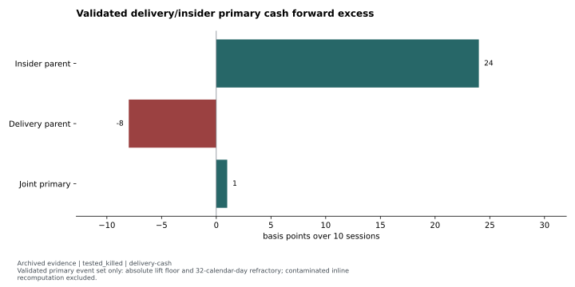
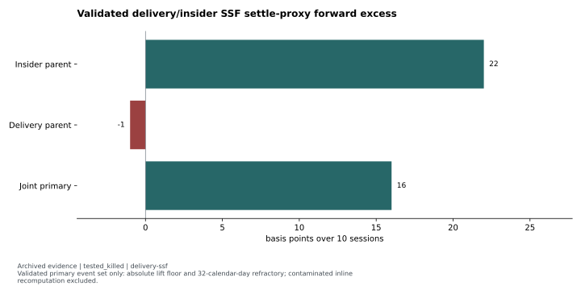
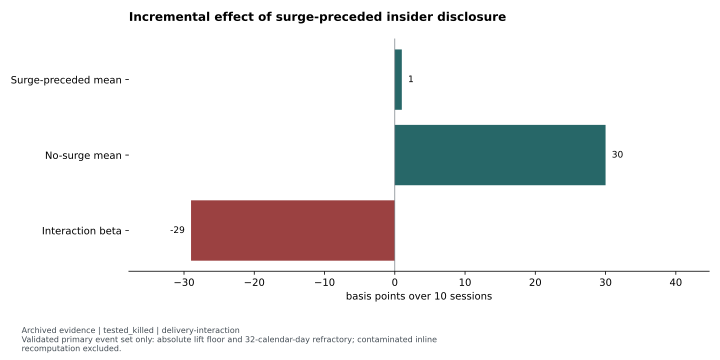

# Delivery and insider interaction: association did not predict returns

**Status:** `tested_killed`. Original verdict: `KILLED`; documented null on the validated primary event set.

Delivery surges and public insider clusters co-occurred far more often than a within-symbol permutation null expected. That association did not translate into predictive forward excess. The interaction test asked a different question and remained null.

## Hypothesis and clocks

The proposed mechanism was informed accumulation: an unusually large delivery-ratio lift before a public cluster of distinct insider purchases might reveal a move not yet fully priced in. The joint event was anchored on the insider disclosure date, with a preceding delivery surge in the declared session window. Public disclosure, not the private transaction date, was the relevant observation clock. The intended entry was the following session.

The validated primary delivery construction used **z > 2.0**, an absolute lift of at least **5 percentage points**, a lagged **60-session** baseline and a **32-calendar-day** refractory. The latter reduced overlapping same-name forward windows that event-date clustering would not otherwise absorb. <!-- claims: delivery-z-threshold, delivery-abs-floor, delivery-baseline, delivery-refractory --> The archived study window was **2015-01-01 through 2026-06-05**, with registration/run on 2026-06-19/20.

## Universe, implementation, benchmark and inference

The source driver formed an intersection from names **ever** observed in the futures panel; it is not historical PIT F&O membership certification. Cash used next-open/forward-close prices. Although the hypothesis referred to next-open SSF trading, the implemented comparison used **settle-to-settle** prices, with artificial narrow high/low values to bypass the solid-bar fillability rejection. Those proxy results do not certify real futures-open fills.

Each path's forward excess was measured against its same-window equal-weight universe. This was a gross base-rate/translation test, without a fully cost-swept executable-book return. Co-occurrence used a within-symbol permutation null; forward means and the interaction regression used event-date cluster-robust inference. The public evidence transcribes the validated primary results rather than recomputing the event set.

## Evidence and figures

The reported **39.9-sigma co-occurrence enrichment** is an association statistic. <!-- claims: delivery-association --> It does not mean the forward-return hypothesis had comparable significance. The reviewed primary event set had **13,815 delivery surges** before fill filtering; the joint primary forward sample contained **328 fillable events**. <!-- claims: delivery-validated-events, delivery-cash-03-fillable-n -->

The [cash comparison](../../evidence/tables/delivery-cash.json) reports **+24 bps** for the insider parent, **−8 bps** for the delivery parent and **+1 bp** for the joint event over the primary forward horizon. The joint cash t statistic was **0.04**. <!-- claims: delivery-cash-01, delivery-cash-02, delivery-cash-03, delivery-cash-03-reported-cash-t -->

The [SSF settle-proxy comparison](../../evidence/tables/delivery-ssf.json) reports **+22, −1 and +16 bps**, respectively. <!-- claims: delivery-ssf-01, delivery-ssf-02, delivery-ssf-03 --> These are instrument-path diagnostics with the disclosed proxy limitation, not certified tradable returns.

The [interaction comparison](../../evidence/tables/delivery-interaction.json) reports **+1 bp** for surge-preceded clusters versus **+30 bps** for no-surge clusters. The regression difference was **−29 bps**, with **t = −0.76**. <!-- claims: delivery-interaction-01, delivery-interaction-02, delivery-interaction-03, delivery-interaction-03-reported-clustered-t --> This is the predictive increment test; it supports no positive incremental edge. The source required-sample estimate exploded to **734,737** at the near-zero joint mean, against the small observed sample. <!-- claims: delivery-required-n -->

## Controlling decision and reusable lesson

Neither the parent nor the registered interaction established a passing predictive mechanism. The campaign remained killed. Favorable threshold/prior-return subsets were post-hoc, sub-threshold and aligned with recent strength rather than the original accumulation hypothesis; they are not promoted here.

The reusable contribution is event-contract discipline. An initial inline recomputation omitted validated filters and produced a different event set. Its result is excluded. The corrected study loaded the prebuilt permutation-validated artifact and failed loudly when it was absent. Evidence of structured flow needs a leading, observable information clock before it becomes a trading hypothesis.

## Limitations and reproduction

Reported means and t statistics are rounded transcriptions. Refractory logic mitigates some same-name overlap; it is not a claim of independent events. The historical universe and SSF proxies constrain execution interpretation. The original workflow also records manually removed duplicate predeclaration rows with a correction entry; those protected ledger contents are excluded and are not presented as fresh certification authority.

These figures are `report_transcription`; their displays can be reproduced from the included tables. Event reconstruction, permutation reruns and historical forward returns require `private_inputs_required`. No row-level disclosure or trading records are bundled.

Evidence: [reviewed featured summary](../../evidence/summaries/featured-evidence.md), [claim registry](../../evidence/claims.json). Original provenance labels: `docs/postmortems/POSTMORTEM_delivery_x_insider_B8.md`, `docs/discovery/DISCOVERY_2026-06-20_B8_delivery_x_insider.md`, `scripts/discovery/discovery_0a_delivery_x_insider.py`.

Methods: [reviewed self-contained examples and attribution](../../docs/METHODS.md). Synthetic examples demonstrate software behavior; they are not market evidence.
