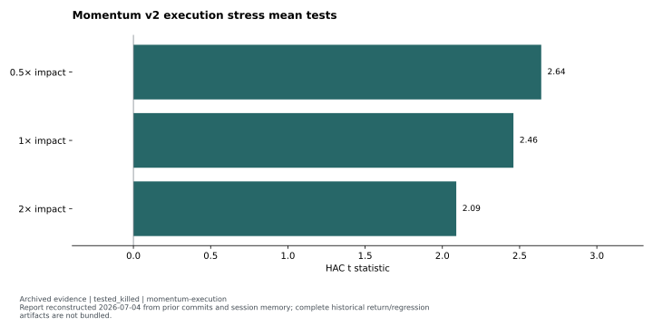
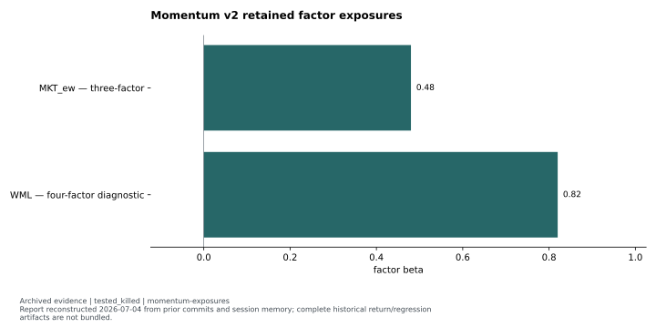
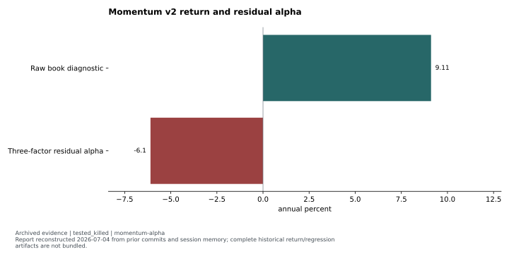

# Momentum v2: a significant spread without residual alpha

**Status:** `tested_killed`. Original source verdict: Phase 0 `PASS` → Phase 1 `FAIL`; documented null.

The executable long/short spread cleared the initial mean-significance gate across its impact sweep. Factor attribution then rejected the claim of independent residual alpha. A positive book return and a statistically nonzero spread were insufficient to certify this strategy.

## Hypothesis and clocks

The hypothesis was that a market-neutral wrapper could retain the historical cross-sectional momentum signal while removing the market exposure that overwhelmed its long-only predecessor. The book bought the top quintile and shorted the bottom quintile through single-stock futures. Its formation signal used lagged adjusted prices and skipped the recent month; rebalance-day prices did not enter that signal. The formation/decision clock was monthly; realized cash and SSF holding paths belonged to the following hold context.

The reported development window was 2015–2026, with **137 rebalances**. <!-- claims: momentum-window, momentum-rebalances --> Exact endpoints are not supplied by the reconstructed canonical report, so they are not invented here. Both legs came from the liquid-cash intersection with the point-in-time F&O pool. Cash longs used dividend total returns; futures shorts used the settle path, with ban, roll and lot constraints. Out-of-sample testing did not open.

## Design, benchmark, costs and inference

Phase 0 asked whether the monthly L/S spread had a significant mean after historically dated statutory costs and each registered impact stress. Phase 1 asked a different question: whether the daily realized book had positive residual alpha after market, value-proxy and illiquidity factors. Published momentum exposure was added as a four-factor diagnostic.

The report uses Newey–West HAC inference with **21 lags**. <!-- claims: momentum-hac-lags --> The primary attribution used central impact. Cash-leg impact had initially been sized from futures ADV, producing non-finite impact on some names. That execution bug was corrected before the Phase 0 verdict, using cash ADV and rejecting non-finite impact names. The resulting mean tests are the reported post-fix values.

## Evidence and figures

The [execution stress results](../../evidence/tables/momentum-execution.json) report HAC t values of **2.64, 2.46 and 2.09** at the three recorded impact multipliers. Every point cleared the **2.0** hurdle; the stressed point had little margin. <!-- claims: momentum-execution-01, momentum-execution-02, momentum-execution-03, momentum-phase0-t-threshold --> Connecting those recorded points does not establish any unobserved stress response.

The [exposure diagnostics](../../evidence/tables/momentum-exposures.json) retain market beta **0.48** from the three-factor model and momentum beta **0.82** from the four-factor diagnostic. <!-- claims: momentum-exposures-01, momentum-exposures-02 --> These are different specifications, not two coefficients from a single displayed regression.

The [return/alpha comparison](../../evidence/tables/momentum-alpha.json) places the raw book's **+9.11% annual return** beside the primary residual alpha of **−6.10% per year**, with **HAC t = −0.98**. <!-- claims: momentum-alpha-01, momentum-alpha-02, momentum-alpha-02-reported-hac-t --> The raw book return is a descriptive diagnostic; residual alpha is the gated quantity.

## Controlling decision and reusable lesson

Phase 1 required positive residual alpha with sufficient HAC significance. Both requirements failed. The source disposition was KILLED, and the alternative hedge/OOS branches were not triggered. The reusable method is to test executability and attribution separately: a long/short mean can be significant while the book remains exposed to familiar factors.

## Limitations and reproduction

The canonical report and postmortem were reconstructed on 2026-07-04 from earlier commits and session memory. The complete saved return/regression artifacts are not bundled. The report's book-versus-raw-momentum arithmetic is inconsistent, so its disputed return difference is omitted. No confidence interval is fabricated from the displayed t statistic. Inactive historical surveillance inputs and incomplete pledge information in the implementation notes further limit any claim of live-ready execution.

These figures are `report_transcription`. Their public rendering is reproducible from the included values, while a fresh historical simulation or factor regression is `private_inputs_required`. None of the results establishes an independent, certified or live strategy.

Evidence: [reviewed featured summary](../../evidence/summaries/featured-evidence.md), [claim registry](../../evidence/claims.json). Original provenance labels: `docs/strategies/REPORT_momentum_xs_v2.md`, `docs/postmortems/POSTMORTEM_momentum_xs_v2.md`, `docs/strategies/IMPL_momentum_xs_v2.md`. Original documents and return paths are excluded.

Methods: [reviewed self-contained examples and attribution](../../docs/METHODS.md). Synthetic examples demonstrate software behavior; they are not market evidence.
