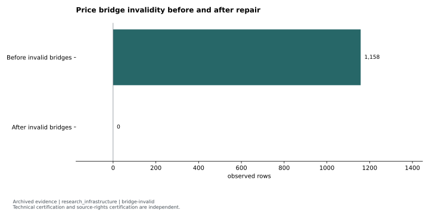
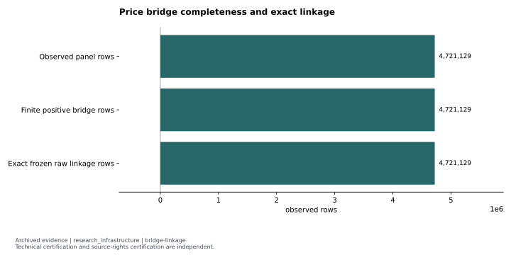
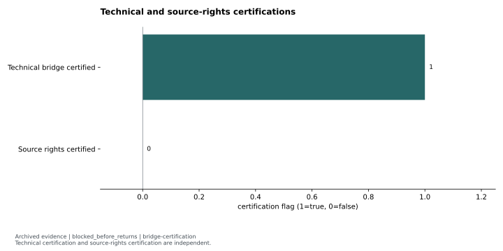

# Price bridge repair: numerical validity and source rights remained separate

**Status:** `research_infrastructure` for the repair; `blocked_before_returns` for downstream readiness. Original certification decision: `source-data-repair-required`.

An adjustment/rounding defect was diagnosed and repaired in a separate vintage. The complete panel then passed numerical bridge validity and exact raw-linkage checks. Source-rights certification still failed. This is a data-engineering case with no strategy-performance claim.

## Question, clocks and scope

The data-only question was whether adjusted signal/performance prices could be connected to finite positive, exactly identified raw observations without manufacturing values. Requested panel coverage was **2015-01-01 through 2026-06-05**. The repair used observations ingested no later than the frozen **2026-06-09** knowledge cutoff and created a separate **2026-08-12** vintage. The original clean vintage remained intact. <!-- claims: bridge-window, bridge-cutoff, bridge-vintage -->

No signal decision clock, holding horizon, benchmark or trading cost estimate applies: no strategy returns, rankings, CAGR, Sharpe or portfolio outcomes were computed. Downstream candidate/fill/mark policies remain fail-closed if exact valid observations are absent.

## Implementation and deterministic validation

The original diagnosis found false unconfirmed split cliffs in low-price tick changes. Chained adjustment factors pushed legitimate positive observations beneath the stored decimal precision, where rounding created zero adjusted closes. Repair logic constrained unconfirmed split inference on low-priced bare cliffs while preserving confirmed corporate-action paths. It also preserved exact frozen raw linkage and bounded knowledge availability.

The earlier diagnosis remains historical context, but the complete later certification supplies the numerical evidence. Synthetic examples can explain the engineering behavior; they cannot establish a market edge or cure source rights.

## Evidence and figures

The [before/after invalidity table](../../evidence/tables/bridge-invalid.json) shows **1,158 invalid observed bridges before repair and zero after**. <!-- claims: bridge-invalid-01, bridge-invalid-02 --> This is a deterministic count, not a return estimate or statistical score.

The [complete-panel linkage table](../../evidence/tables/bridge-linkage.json) records **4,721,129 observed rows**, **4,721,129 finite positive bridges** and **4,721,129 exact raw-linked rows**. <!-- claims: bridge-linkage-01, bridge-linkage-02, bridge-linkage-03 --> These overlapping counts describe the same observed panel; they must not be summed. No raw ID or row-level exception is included in the public derivative.

The [certification table](../../evidence/tables/bridge-certification.json) keeps the two dimensions explicit: **technical bridge certification = true; source-rights certification = false**. <!-- claims: bridge-certification-01-source-boolean, bridge-certification-02-source-boolean --> The chart uses an explicitly declared boolean encoding, not performance scores. The archived governance registry mapped all linked rows to source classes marked `UNUSABLE`; fully usable rows therefore remained zero. <!-- claims: bridge-rights-unusable-all, bridge-fully-usable -->

## Controlling decision and reusable lesson

Exact linkage proves where observations came from. It does not grant automation, retention or derived-use rights. The archived readiness decision remained `source-data-repair-required`, and no return-bearing successor prompt was emitted. No present-day legal or policy determination is made by this handoff.

The reusable engineering contribution is the separation of numerical validity, source identity, knowledge-time discipline and rights. A passing technical repair can coexist with a correctly blocked research continuation.

## Limitations and reproduction

Zero invalid **observed** bridges does not mean a fully dense symbol/session panel: exact-session gaps and flagged corporate-action boundaries remained explicit. A held position without an exact valid mark invalidates its fold under the registered policy. The earlier complete receipt was unavailable in the audit; the later complete certification is used rather than inventing missing evidence. Restricted market observations, source-rights decision packets, raw identifiers, symbols and exception date ranges are omitted.

The selected counts and certifications are `archived_result` derivatives. Public display transformations can be repeated from the included tables. Rebuilding the panel or certifying underlying market observations requires `private_inputs_required` and appropriate source authorization. This case makes no claim that technical repair supplies such authorization.

Evidence: [reviewed featured summary](../../evidence/summaries/featured-evidence.md), [claim registry](../../evidence/claims.json). Original provenance labels: `docs/strategies/REPORT_trend_following_price_bridge_remediation_v1.md`, `docs/strategies/REPORT_trend_following_price_bridge_certification_v1_1.md`, `data/research/trend_following_price_bridge_certification_v1_1/before_after_validation_summary.json`.

Methods: [reviewed self-contained examples and attribution](../../docs/METHODS.md). Synthetic examples demonstrate software behavior; they are not market evidence.
