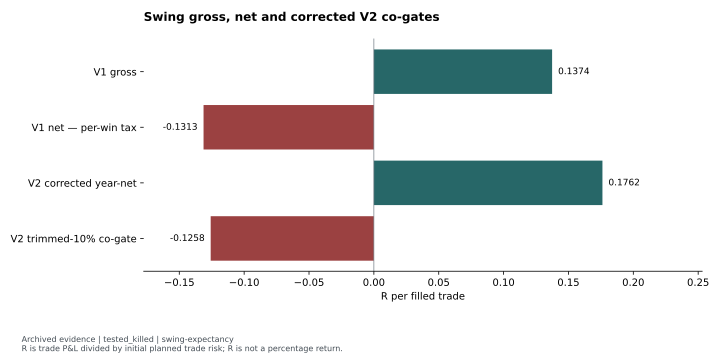
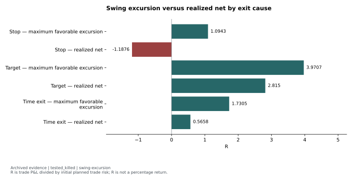
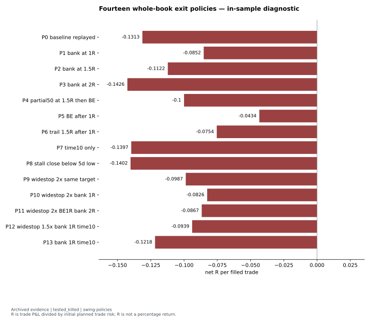

# Swing exit autopsy: excursion, costs and a failed repair

**Status:** `tested_killed`. Original verdicts: V1 `FAIL`; corrected V2 `KILL`.

The mechanical swing replay lost net of modeled costs despite positive gross expectancy. Large favorable excursions were often surrendered, but post-hoc exit policies did not rescue the whole book. The corrected V2 mean became positive without changing its kill verdict: robustness co-gates still failed.

## Hypothesis and clocks

V1 replayed the structure/relative-strength/trigger core of a weekly swing screener. The diagnostic hypothesis was that sound entries were being wasted by rigid stops, distant targets and a fixed time exit. Weekly as-of decisions used truncated history; eligible breakout and resting-pullback triggers then entered through conservative daily-bar conventions. The study was not a test of discretionary judgment, live fills or earnings-severity decisions.

The window was **2022-01-03 through 2026-06-05**. <!-- claims: swing-window --> Membership was `current_only`; it has an upward survivorship bias. Relative strength and market regime used an equal-weight panel proxy rather than historical index candles. Adjusted prices came from a single later vintage, limiting historical PIT adjustment claims even though decision bars were truncated.

## Execution, cost units and inference

**R** divides trade P&L by initial planned trade risk. It is not a percentage portfolio return. V1 used notional friction and a conservative per-winning-trade tax wedge without annual loss netting. V2's corrected primary line applied annual net tax in constant-risk-per-trade R units; the earlier rupee-per-share ratio had unintentionally price-weighted trades. These different designs and tax conventions cannot identify an isolated causal improvement.

Registered gates used net expectancy, a bootstrap interval and a shuffled-date placebo, with additional hit-rate/regime or trimmed-body requirements. The autopsy reused V1 fills and recorded conservative bar/cost conventions; it was in-sample diagnostic work.

## Evidence and figures

V1 generated **479 events and 228 scored fills**. <!-- claims: swing-v1-events, swing-v1-fills --> The [expectancy comparison](../../evidence/tables/swing-expectancy.json) shows **+0.1374R gross** and **−0.1313R net**. V1's bootstrap interval, **[−0.3240R, +0.0726R]**, included zero; its mean missed the **+0.15R** gate. <!-- claims: swing-expectancy-01, swing-expectancy-02, swing-v1-ci-low, swing-v1-ci-high, swing-net-threshold -->

The [exit-cause aggregates](../../evidence/tables/swing-excursion.json) show time exits at mean **1.7305R MFE** but **0.5658R realized net**, a recorded mean giveback of **1.1647R**. <!-- claims: swing-excursion-05, swing-excursion-06, swing-time-giveback --> MFE is the favorable path excursion, not a return available at a known decision clock. Grouping by realized exit reason is descriptive, not causal evidence for a new exit rule.

The [whole-book policy grid](../../evidence/tables/swing-policies.json) contains **14 policy rows, including the baseline**. Every row is negative; exact saved means range from **−0.1426R to −0.0434R**. <!-- claims: swing-policy-count, swing-policy-min, swing-policy-max --> The hindsight peak-exit ceiling and favorable subset maxima are excluded. Policy results were selected from aggregate JSON, without reading or exporting trade identities, dates or prices.

## Controlling decision and reusable lesson

Corrected V2 used **94 fills** and reported **+0.1762R** primary year-net mean. <!-- claims: swing-v2-fills, swing-expectancy-03 --> That passed the mean gate, but trimmed-10% expectancy was **−0.1258R**, the bootstrap interval **[−0.1371R, +0.4162R]** included zero, and placebo **p = 0.1343** failed. <!-- claims: swing-expectancy-04, swing-v2-ci-low, swing-v2-ci-high, swing-v2-placebo-p --> The source verdict remained `KILL`. Its historical replay was explicitly kill-only on the spent design window; it could not certify a pass even if all displayed metrics had looked favorable.

The reusable contribution is accounting and diagnostic discipline: separate gross opportunity, executable realization, costs in risk units and a robust trade body. Management overlays are hypotheses requiring new evidence, not proof supplied by a favorable excursion or a searched subset.

## Limitations and reproduction

The original postmortem rounded its policy range; this derivative preserves the exact saved JSON values. V2's bear-regime expectancy is null, as is its regime-sign metric. The mechanical scorecard's passing regime check does not create an observed bear sample. Both versions retain current-membership and benchmark limitations. Forward paper evidence was intended to be primary confirmation; no useful qualifying forward sample is established by this handoff.

The figures are `archived_result` derivatives of saved aggregate JSON, with corrected V2 checked against its canonical report. Display transformations can be repeated publicly. Historical fill replay and counterfactual recomputation are `private_inputs_required`.

Evidence: [reviewed featured summary](../../evidence/summaries/featured-evidence.md), [claim registry](../../evidence/claims.json). Original provenance labels: `screener/validation/outputs/v1_exit_autopsy.json`, `screener/validation/outputs/v2_replay_curr_2026-06-05.json`, `docs/strategies/REPORT_screener_swing_v2.md`.

Methods: [reviewed self-contained examples and attribution](../../docs/METHODS.md). Synthetic examples demonstrate software behavior; they are not market evidence.
