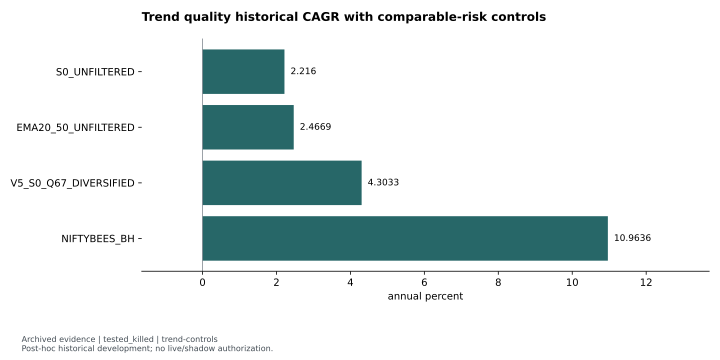
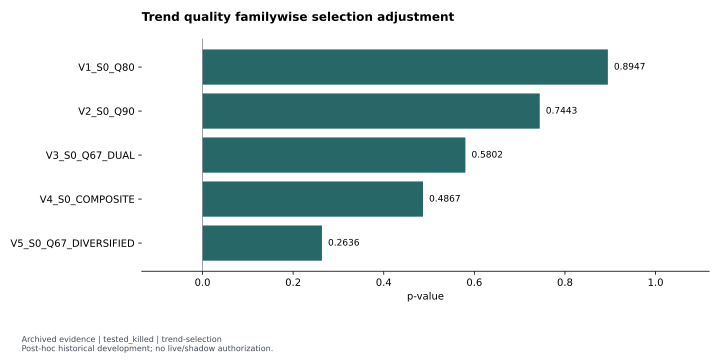
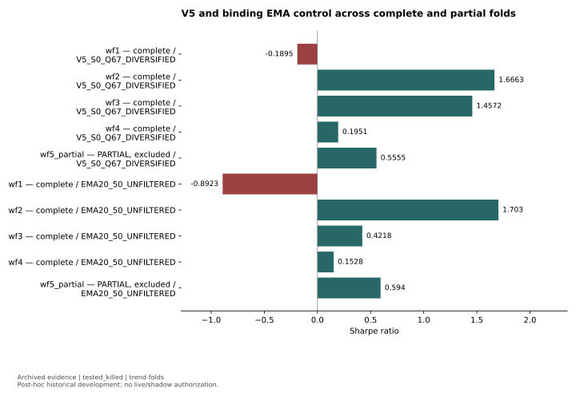

# Trend quality: attractive historical metrics failed the family gates

**Status:** `tested_killed`. Original final decision: `kill-quality-family`; HQ `falsified`, HR `falsified`; priority-selected variant `none`.

The diversified quality variant had positive historical CAGR and relatively modest drawdown. It still failed incremental-information, complete-fold stability, concentration and familywise selection requirements. This result rejects the registered quality family on reused development history; it does not reject slow-trend investing in general.

## Hypothesis and clocks

The immediate-entry follow-up asked whether a lagged measure of price-path smoothness added information beyond the slow-trend ranking signal, and whether that information supported robust risk-efficient returns. Quality was the trailing log-adjusted-price/time regression R², measured strictly through **t−1**. Each expanding fold calibrated its thresholds only on training-period slow-trend onset events. Weekly portfolio decisions happened after close, with fills at the next exact session open.

The panel window was **2015-01-01 through 2026-06-05**; walk-forward test history began in 2018. <!-- claims: trend-training-window, trend-testing-start --> The liquid-cash universe required prior observations, positive adjusted OHLC and lagged traded-value eligibility. Signals used corporate-action-adjusted prices; performance used dividend total-return prices. Integer-share portfolios retained cash when underinvested, with sector/cluster/position constraints and no leverage.

## Controls, costs and inference

Unfiltered S0 was the direct differential comparator. Unfiltered EMA20/50 was the **binding** timing comparator. The already-observed V0 reference and quality-filtered EMA diagnostic were not selectable fresh candidates or substitutes for that binding control. NIFTYBEES buy-and-hold provided an exposure/risk reference.

Saved costs included delivery-equity statutory charges, the DP charge and **5 bps per side** base slippage. <!-- claims: trend-base-slippage --> Direct quality regressions used slow score, beta, sector and fold controls with date/symbol clustering. Selection adjustment used common moving-block resamples and a familywise max-t statistic versus S0. These were post-hoc historical development studies, despite their study-local preregistration receipts.

## Evidence and figures

The [CAGR/control table](../../evidence/tables/trend-controls.json) records V5 historical **4.30% CAGR**, **0.81 Sharpe** and **−9.55% maximum drawdown**. <!-- claims: trend-controls-03, trend-controls-03-sharpe, trend-controls-03-maximum-drawdown --> Its average market exposure was **20.72%**, compared with almost full exposure for buy-and-hold. <!-- claims: trend-controls-03-market-exposure, trend-controls-04-market-exposure --> The table retains annualized volatility and the recorded CAGR scaled to EMA's risk: V5 **4.03%**, versus unfiltered EMA's **2.47%**. <!-- claims: trend-controls-03-vol-matched-cagr-to-EMA20-50-UNFILTERED, trend-controls-02 --> Raw buy-and-hold CAGR is therefore not a like-risk comparison.

The [selection-adjustment table](../../evidence/tables/trend-selection.json) shows V5 familywise max-t **p = 0.263574**, rounded to **0.264**. <!-- claims: trend-selection-05 --> All selectable variants failed the familywise requirement. V5's positive selected metrics could not substitute for this gate.

The [complete/partial fold table](../../evidence/tables/trend-folds.json) shows V5 and the unfiltered EMA control over every recorded fold. V5 passed the conjunctive requirements in **two of four complete folds**, below the required **three**. <!-- claims: trend-v5-complete-passes, trend-complete-folds, trend-complete-required --> The separately labelled `wf5_partial` was shown descriptively and did not count as another complete fold.

## Controlling decision and reusable lesson

The primary direct-quality test at the registered medium horizon had **two-way t = −0.624476** and **Bonferroni p = 1.0**. <!-- claims: trend-direct20-two-way-clustered-t, trend-direct20-bonferroni-p-value --> Incremental quality information was not established. V5 also failed concentration, complete-fold stability and selection adjustment. No priority-selected variant remained, so the allowed decision was `kill-quality-family`.

The supporting TSS diagnosis had already shown that confirmation timing could miss returns and that quality filtering could improve some descriptive economics without passing incremental-information and robustness requirements. Its registered overall verdict was `kill`, with narrower hypothesis outcomes preserved in the archive. The reusable methods are strictly lagged quality computation, training-only fold calibration, risk-matched controls and an explicit familywise selection test.

## Limitations and reproduction

The history was reused and development-only. The TSS diagnostic seal references an engine whose bytes later changed; current-code parity is not promised. Exact-session gaps and fail-closed execution rules affect the panel. Daily trend NAV/returns were not persisted, so equity curves, underwater charts and rolling-Sharpe graphics are unavailable. Summary CAGR is not used to invent a time series.

These selected CSV fields are `archived_result` derivatives. Unit conversion is limited to multiplying fractional rates and exposure by one hundred; no new market inference is performed. Historical simulation, raw panels and bootstrap replication are `private_inputs_required`. Public display validation uses the included tables and claim registry.

Evidence: [reviewed featured summary](../../evidence/summaries/featured-evidence.md), [claim registry](../../evidence/claims.json). Original provenance labels: `docs/strategies/REPORT_trend_quality_immediate_entry_v1.md`, `data/research/trend_quality_immediate_entry_v1/strategy_comparison.csv`, `data/research/trend_quality_immediate_entry_v1/gate_matrix.csv`.

Methods: [reviewed self-contained examples and attribution](../../docs/METHODS.md). Synthetic examples demonstrate software behavior; they are not market evidence.
